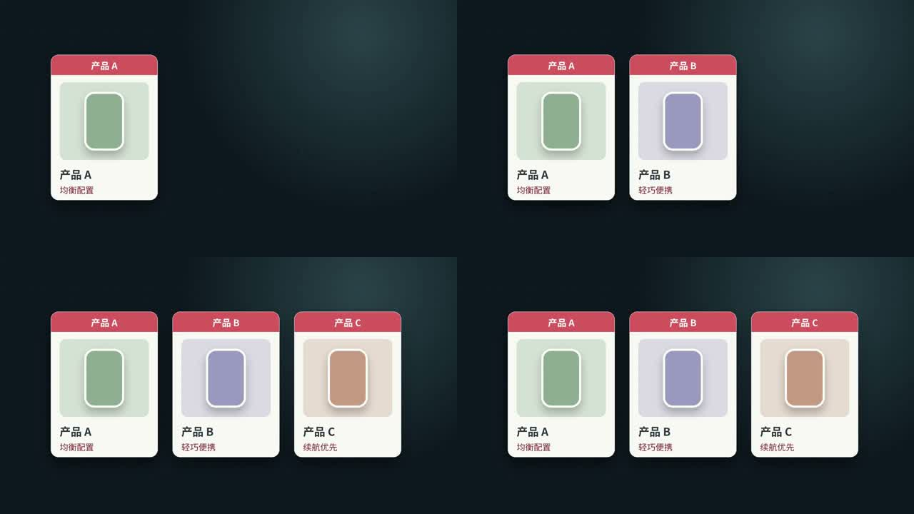

# Knowledge Video Motion｜知识视频动效 Skill

**状态：持续更新中。** 后续会继续补充动效配方、可编辑示范和不同画幅的适配案例。

把知识讲解和产品选购视频里常见的字幕、卡片、分屏、清单与价格分档效果，整理成可选择、可修改的动效配方。目前收录 **23 张配方卡**，每张都有一个 **16:9、5 秒以内**的 MP4 示范和 HTML 可编辑工程。



先看[动效选用目录](动效选用目录.md)：只列名称、效果、使用场景、注意点，并能打开对应视频。需要实现时再读[配方卡](references/recipes/)或[可编辑案例索引](examples/README.md)。

## 安装与调用

将仓库克隆或复制到 Codex 的 skills 目录，并保持文件夹名为 `knowledge-video-motion`：

```bash
git clone https://github.com/wenquancheng093-tech/knowledge-video-motion.git ~/.codex/skills/knowledge-video-motion
```

之后可以直接说：

> 调用 `knowledge-video-motion`。根据这段文案的信息结构，从动效选用目录选 2～3 个合适的效果，说明为什么选它们，并把选中的效果用于视频。

也可以指名编号，例如“商品清单用 FX-021，价位判断用 FX-022”。Skill 会按实际文案、画幅、人物或商品素材重新排版与定时；预览秒数不等于正式视频时长。

## 编辑示范

MP4 已可直接观看。若要修改 HTML 示例，先安装 Node.js，再运行：

```bash
cd examples
npm install
cd FX-010
npx --yes hyperframes@0.8.152 check
npx --yes hyperframes@0.8.152 render
```

`npm install` 会安装 GSAP 并为 23 个示例准备本地脚本。每个案例的 `data/*.js` 存放文案与商品数据，`index.html` 存放动画与排版。仓库不打包 GSAP 的发行文件或字体文件；示例默认使用系统中文无衬线字体，换字体或文案后请重新检查画面。运行依赖及许可见[第三方说明](THIRD_PARTY.md)。

## 当前范围

- 23 张配方卡均有横屏单例；竖屏版尚未制作。
- FX-005、FX-009、FX-010 等卡含多个子效果，当前视频只示范其中一个，范围写在配方卡中。
- 案例用自制图形与占位内容。正式视频需替换真实文案、已核实的商品信息，并删掉示范标记和解释性小字。
- 仓库仅含抽象动效配方与自制示范，不发布收集时使用的参考链接、原视频或截图。

Skill 正文见 [SKILL.md](SKILL.md)。本仓库原创文本、动画工程与示范媒体按 [MIT License](LICENSE) 发布；第三方依赖遵循各自许可。
